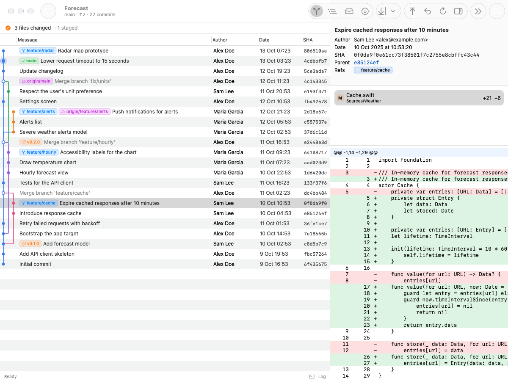

# GitGui

A native Git client for macOS, written in SwiftUI, with a GitKraken-style commit graph.
It drives the system `git` binary, so your config, SSH keys, credential helpers and hooks
work exactly as they do in the terminal.

<picture>
  <source media="(prefers-color-scheme: dark)" srcset="docs/screenshot-dark.png">
  
</picture>

## Features

- **Commit graph** — lanes with colours, branch, tag, HEAD and stash labels, merge commits;
  history is loaded in pages, so large repositories scroll smoothly.
- **Everyday work without a terminal** — stage and unstage files or single hunks, commit and
  amend, branches and tags, fetch, pull, push with upstream, stash, discard.
- **Kraken-style history editing** — drag a branch onto another to merge, rebase or
  fast-forward; cherry-pick, revert, reset; interactive rebase in its own window;
  undo the last action via the reflog (⌥⌘Z).
- **Conflicts** — a side-by-side conflict editor (ours, theirs, result) or your own
  merge tool via `git mergetool`.
- **GitHub and self-hosted GitLab** — pull/merge request badges on branches and CI status
  on commits, fetched in batches over GraphQL. Tokens come from the keychain or are reused
  from `gh` and `glab`.
- **Many repositories** — favorites and groups in the sidebar, ⌘1…⌘9, and a ⌘K command
  palette for repositories, branches and commands.
- **Submodules, worktrees and Git LFS** are shown for what they are instead of raw pointers.

## Keyboard shortcuts

| Action | Shortcut |
|---|---|
| Command palette | ⌘K |
| Fetch / Pull / Push | ⇧⌘F / ⇧⌘L / ⇧⌘P |
| Commit | ⌘↩ |
| Stage all / Unstage all | ⇧⌘A / ⌥⇧⌘A |
| New branch / New tag | ⇧⌘N / ⇧⌘T |
| Branches and tags / Stash | ⌘B / ⌘S |
| Changes panel | ⇧⌘C |
| Undo last action | ⌥⌘Z |
| Continue merge or rebase | ⇧⌘↩ |
| Find commit / Go to HEAD | ⌘F / ⇧⌘H |
| Switch repository | ⌘1…⌘9, ⌥⌘↑ / ⌥⌘↓ |
| Open in editor / Terminal | ⌥⌘E / ⌥⌘T |

## Download

Grab `GitGui.zip` from the [latest release](https://github.com/danakishi/git-gui/releases/latest),
unzip it and move `GitGui.app` to Applications. It runs on macOS 26 or later, on Apple silicon
and Intel.

The app is not notarized, so macOS blocks the first launch. Either open it once via
System Settings → Privacy & Security → Open Anyway, or clear the quarantine flag:

```sh
xattr -dr com.apple.quarantine /Applications/GitGui.app
```

## Building

Requires macOS 26 or later and Swift 6.2 (Xcode or the command line tools). No Xcode
project is needed: the app is a Swift package.

```sh
scripts/build-app.sh          # debug build into .build/GitGui.app
scripts/build-app.sh run      # build and launch
scripts/build-app.sh release  # optimised build
scripts/build-app.sh release universal  # arm64 + x86_64, as in the releases
swift test                    # unit tests, many of them against a real git
```

The app is signed ad hoc, which is enough to run it locally.

## Layout

| Module | Purpose |
|---|---|
| `GitCore` | Runs `git` and parses its output: log, refs, status, diffs, history operations. No UI. |
| `GraphLayout` | Lays commits out in lanes. Pure functions with tests. |
| `Hosting` | GitHub and GitLab providers: pull/merge requests and CI over GraphQL. |
| `GitGui` | The SwiftUI app. |
